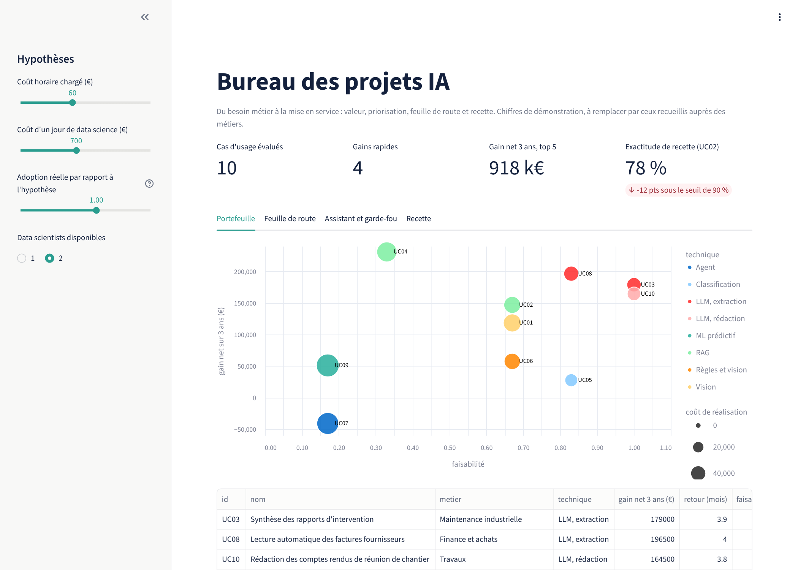
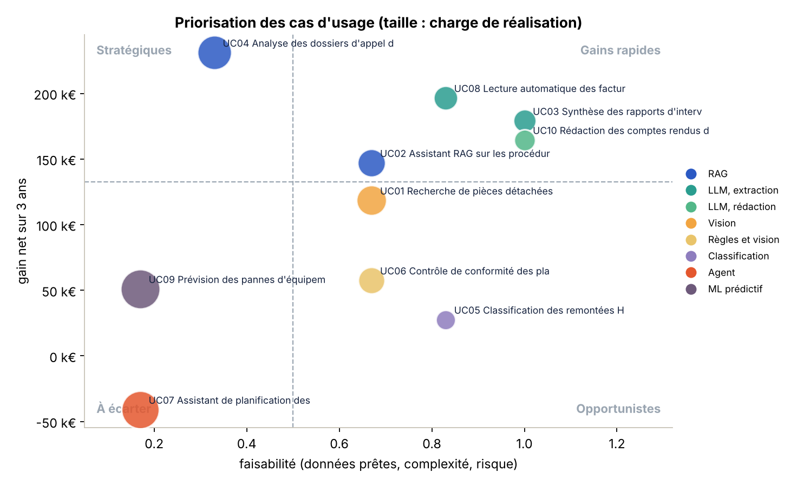
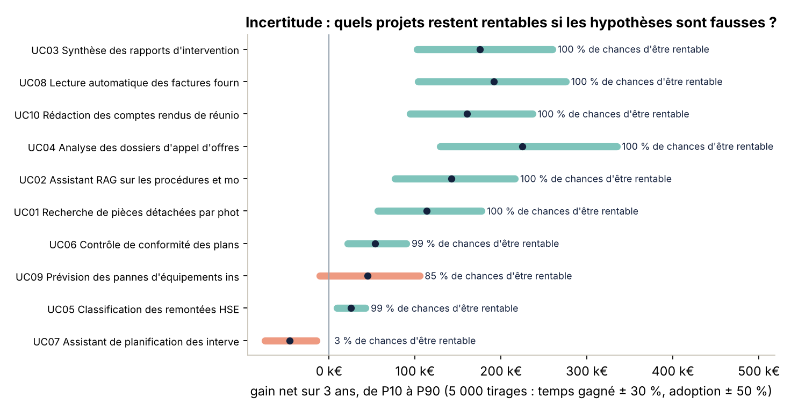
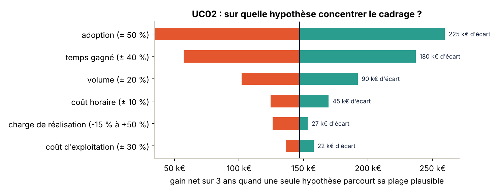
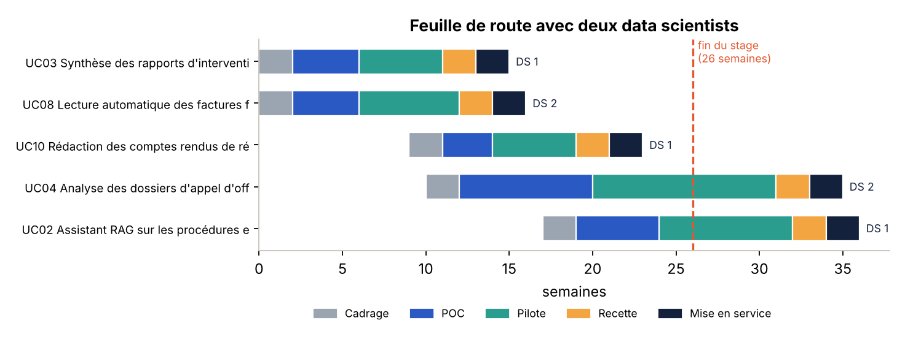
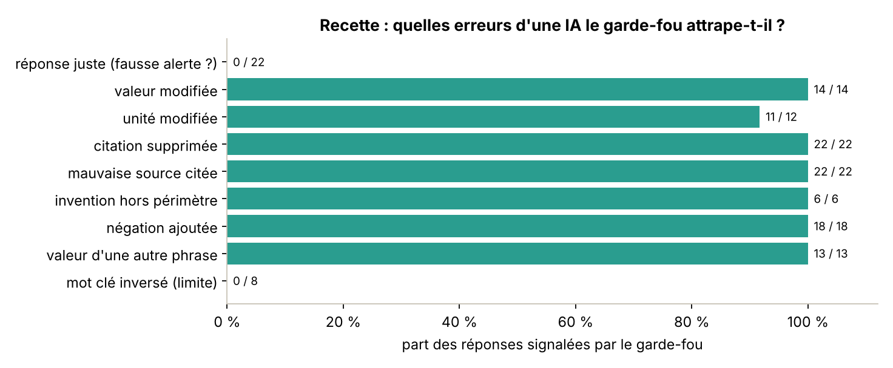
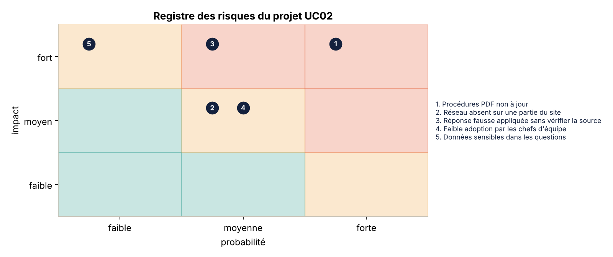
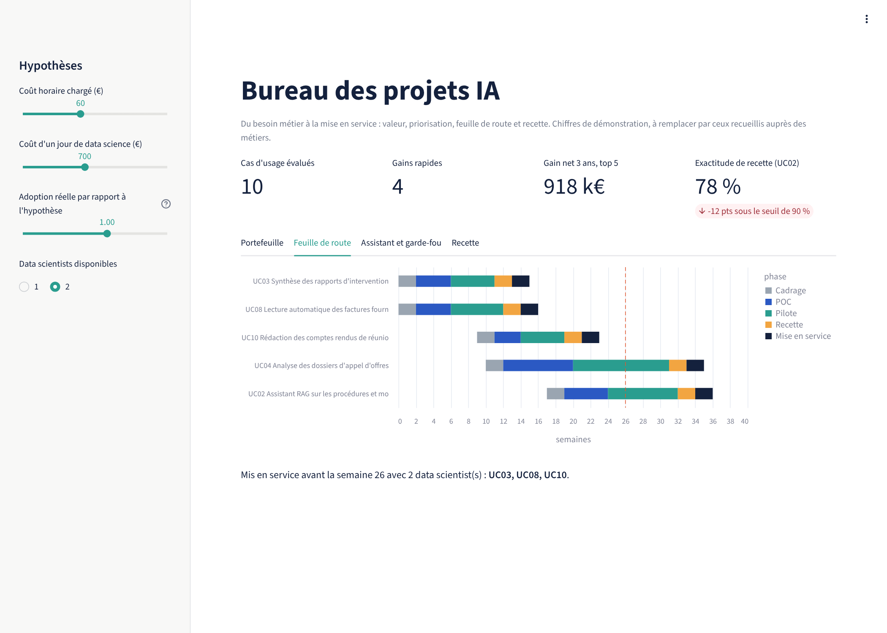
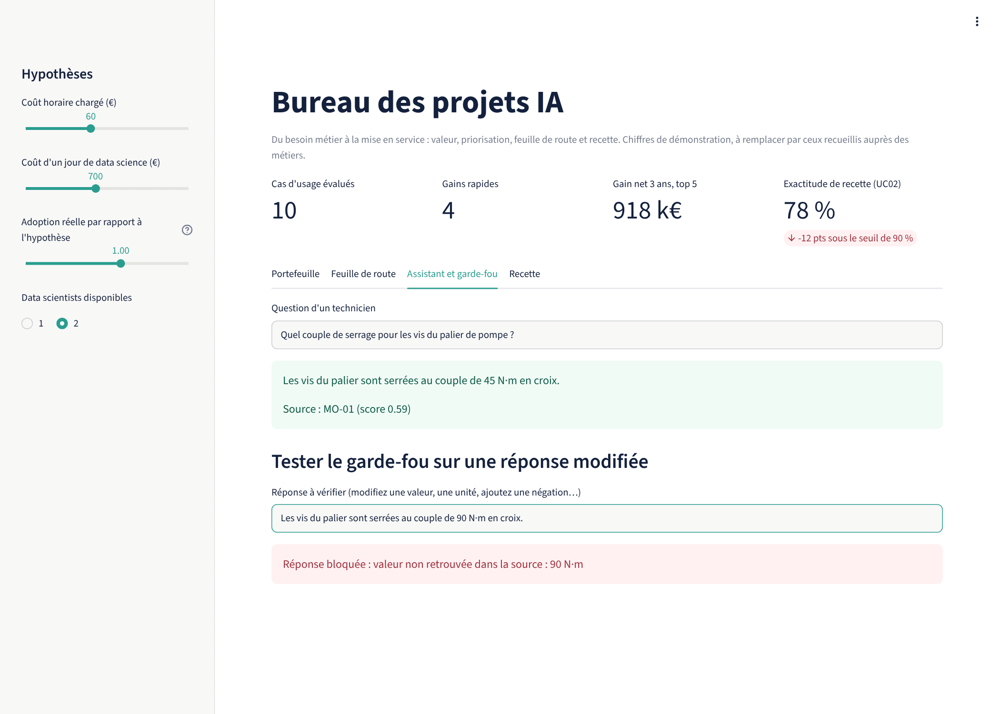
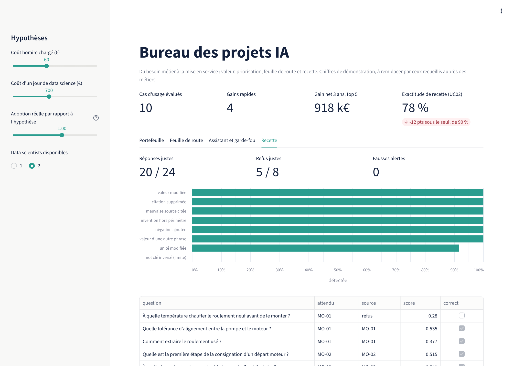

# ai-project-office

**Le bureau d'un chef de projet IA : du besoin métier au ROI, de la feuille de route à la recette, jusqu'à la décision
de mise en service.**

  



Un chef de projet IA ne code pas le modèle : il transforme un besoin flou en cas d'usage chiffré, choisit ce qui mérite
d'être lancé, planifie avec les data scientists, vérifie avant la mise en service que l'IA répond juste, et fait
arbitrer le sponsor. Ce dépôt outille ces cinq étapes, avec des hypothèses explicites et des résultats reproductibles.

| Étape | Ce que fait le dépôt | Où |
|---|---|---|
| 1. Recueil du besoin | Fiche d'expression de besoin : problème, volume, données, critère de succès, risque | [`docs/templates/`](docs/templates) |
| 2. Valeur et priorisation | Gain, coût, ROI sur 3 ans, faisabilité, quadrant, incertitude, sensibilité | [`aipo/portfolio.py`](aipo/portfolio.py) |
| 3. Feuille de route | Cadrage, POC, pilote, recette, mise en service, avec 1 ou 2 data scientists | [`aipo/roadmap.py`](aipo/roadmap.py) |
| 4. Recette | Jeu de 64 questions, seuil réglé sur une moitié, mesuré sur l'autre, garde-fou éprouvé par injection d'erreurs | [`aipo/evaluate.py`](aipo/evaluate.py) |
| 5. Pilotage | Comité projet généré automatiquement : météo, jalons, risques, décision demandée | [`docs/comite/comite_S08.md`](docs/comite/comite_S08.md) |
| Tableau de bord | Hypothèses réglables, portefeuille, feuille de route, assistant et garde-fou en direct | [`app.py`](app.py) |

> Les dix cas d'usage décrivent les métiers d'un groupe de services en énergie et en industrie (maintenance, travaux,
> appels d'offres, HSE, achats). **Tous les chiffres sont des hypothèses de démonstration** et les modes opératoires sont
> **fictifs** : ils sont là pour montrer la méthode et doivent être remplacés par ceux recueillis auprès des métiers.

## 1. Priorisation : quels cas d'usage lancer d'abord ?



| Cas d'usage | Gain net 3 ans | Retour | Quadrant | Chances d'être rentable |
|---|---:|---:|---|---:|
| UC03 Synthèse des rapports d'intervention | 179 k€ | 3,9 mois | Gain rapide | 100 % |
| UC08 Lecture automatique des factures fournisseurs | 197 k€ | 4,0 mois | Gain rapide | 100 % |
| UC10 Comptes rendus de réunion de chantier | 165 k€ | 3,8 mois | Gain rapide | 100 % |
| UC04 Analyse des dossiers d'appel d'offres | 231 k€ | 6,3 mois | Stratégique | 100 % |
| UC02 Assistant sur les modes opératoires | 147 k€ | 6,5 mois | Gain rapide | 100 % |
| UC09 Prévision des pannes | 51 k€ | 17,7 mois | À écarter | 85 % |
| UC07 Assistant de planification | -41 k€ | 51 mois | À écarter | 3 % |

* Les cas d'usage simples (extraction, synthèse, rédaction) sont les plus rentables à court terme : données prêtes, peu
  de risque, mise en service en un trimestre.
* L'analyse des appels d'offres rapporte le plus, mais sa faisabilité est faible : un cadrage dédié s'impose avant de
  s'engager.
* L'assistant de planification n'est rentable que dans 3 % des tirages : sans données de compétences et d'habilitations
  propres, il ne faut pas le lancer.



Chaque hypothèse est tirée 5 000 fois (temps gagné ± 30 %, adoption ± 50 %, charge de réalisation de -15 % à +30 %). Un
projet n'est retenu que s'il reste rentable dans la grande majorité des cas.



Pour l'assistant sur les modes opératoires, l'adoption pèse plus que tout le reste : entre une adoption deux fois plus
faible et une fois et demie plus forte, le gain net passe de 35 k€ à 260 k€. Le cadrage doit donc mesurer l'usage réel
sur le terrain, et le pilote doit suivre l'adoption semaine après semaine, avant de discuter du coût de réalisation.

## 2. Feuille de route



Avec deux data scientists, trois projets sont mis en service en 23 semaines et deux autres passent en pilote. Le cadrage
du projet suivant se fait pendant la fin du projet en cours, pour que les data scientists enchaînent sans attente. Le
tableau de bord recalcule le plan avec un seul data scientist.

## 3. Recette : l'assistant est-il prêt pour la mise en service ?

Le dépôt contient un assistant de recherche minimal (recherche hybride sur caractères et mots, refus sous un seuil), six
modes opératoires **fictifs** et 64 questions écrites comme un technicien les poserait, dont 16 hors périmètre. Le seuil
de refus et le poids des mots sont réglés sur la moitié des questions ; le résultat est mesuré sur l'autre moitié.

| Indicateur (32 questions de test) | Résultat |
|---|---:|
| Réponses justes et sourcées | 20 / 24 |
| Refus justes sur les questions hors périmètre | 5 / 8 |
| Exactitude globale | **78 %**, pour un seuil de mise en service fixé à 90 % |
| Fausses alertes du garde-fou sur des réponses justes | 0 / 22 |

**L'assistant n'est pas prêt**, et c'est un résultat utile : il répond encore à des questions hors sujet qui partagent
des mots avec une procédure (« délai de livraison d'un moteur de 55 kW »). Le rapport de comité en tire la décision et
les options : passer à une recherche sémantique, réduire le périmètre du pilote ou compléter le corpus.



Le garde-fou vérifie chaque réponse contre la phrase qu'elle cite : citation présente, chaque valeur avec son unité
retrouvée dans la source, même nombre de négations, vocabulaire couvert. Des réponses justes sont dégradées comme le
ferait une IA générative peu fiable. Il bloque les valeurs modifiées (14 sur 14), les valeurs reprises d'une autre phrase
(13 sur 13), les négations ajoutées (18 sur 18), les citations absentes ou fausses et les inventions hors périmètre. **Il
ne voit pas un mot clé inversé** (« ouverte » remplacé par « fermée », 0 sur 8) : un contrôle lexical ne comprend pas le
sens. La parade figure dans le plan de recette : source affichée à chaque réponse et formation des utilisateurs à la
vérifier.

## 4. Comité projet



`python run.py` produit [`docs/comite/comite_S08.md`](docs/comite/comite_S08.md) à partir du suivi des jalons, du
registre des risques et des résultats de recette : météo délais, qualité et risques, écarts sur les jalons, risques
classés par criticité avec leur porteur, et décision demandée au sponsor.

## 5. Tableau de bord

| Feuille de route | Assistant et garde-fou | Recette |
|---|---|---|
|  |  |  |

Les curseurs (coût horaire, coût d'un jour de data science, adoption réelle, nombre de data scientists) recalculent le
portefeuille et la feuille de route. L'onglet assistant permet de poser une question puis de modifier la réponse pour voir
le garde-fou la bloquer.

## Lancer

```bash
pip install -r requirements.txt
pytest -q             # 11 tests
python run.py         # résultats dans results/, figures dans docs/figures/, rapport de comité dans docs/comite/
streamlit run app.py  # tableau de bord
```

Pour un vrai portefeuille : remplacer `data/use_cases.yaml` par les cas d'usage recueillis avec les métiers,
`data/corpus/` et `data/qa.yaml` par les documents et le jeu de recette du projet, et `data/suivi_projet.yaml` par le
suivi réel.

## Limites

* Les chiffres sont des hypothèses : leur intérêt est d'être discutables avec le métier, pas d'être exacts.
* L'assistant est volontairement simple et extractif : il sert de référence et de banc d'essai pour la recette et le
  garde-fou. Un assistant génératif branché sur un LLM passerait exactement par la même recette.
* La feuille de route suppose des data scientists à temps plein et ne modélise pas les délais d'accès aux données,
  souvent le premier risque d'un projet d'IA.

## Licence

MIT
